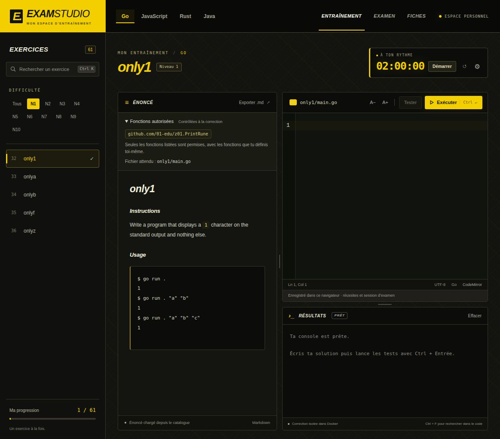
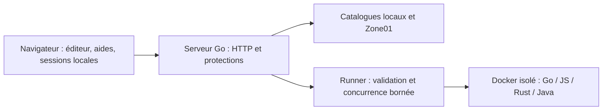

# Z01 Fake Exam

**Un espace personnel pour s’entraîner aux exercices Zone01 en Go, JavaScript,
Rust et Java, puis simuler un examen.**

Éditeur CodeMirror, consignes, exécution Docker, aides progressives et interface
sombre personnalisable. Ce dépôt est une version personnelle privée basée sur
le projet open source [z01exam/z01exam](https://github.com/z01exam/z01exam).
Il n’est ni édité ni validé par Zone01.

[Prise en main](#démarrer-en-local) · [Architecture](docs/maintenance.md) ·
[Sécurité](SECURITY.md) · [Mise en ligne](docs/mise-en-ligne.md) ·
[Provenance](docs/provenance.md) · [Changements](CHANGELOG.md) · [Dépôt GitHub](docs/depot-github.md)



## Démarrer en local

Prérequis : Go 1.22 minimum (version stable récente recommandée), Docker démarré
avec conteneurs Linux. Node.js 22 et npm sont nécessaires pour développer et tester
l’interface, mais les fichiers navigateur compilés sont déjà versionnés.

```sh
git clone https://github.com/alexledanois27-dev/z01-fake-exam.git
cd z01-fake-exam
PORT=8092 make start
```

L’accès au dépôt privé nécessite ton compte GitHub autorisé. Ouvrir
[http://127.0.0.1:8092](http://127.0.0.1:8092), puis arrêter avec `Ctrl+C`.
Sans Make : `PORT=8092 go -C backend run ./cmd/dev`.
Sans `PORT`, le port par défaut est 8080. Le lancement local ne déploie rien.

Le serveur a besoin d’Internet pour récupérer les catalogues et les images Docker
manquantes. Les programmes soumis s’exécutent ensuite sans réseau dans Docker.
Les catalogues externes ne sont pas intégralement disponibles hors ligne.

## Parcours disponibles

| Mode | Fonctionnement |
| --- | --- |
| Entraînement | Choix du langage, niveau et exercice ; aides progressives ; réussites conservées ; pas de chronomètre. |
| Examen libre | Série future masquée, sans timer ; possibilité de passer un exercice. |
| Examen réel | 3 heures, aucun saut, passage automatique après réussite ; bilan au rendu ou à l’expiration. |
| Fiches | Révisions Markdown, avec espace de lecture élargi. |

En examen réel, les onglets internes sont masqués et verrouillés jusqu’au rendu.
Le plein écran est demandé ; une sortie de plein écran ou un changement d’onglet
impose un écran de reprise, sans arrêter le temps. Le navigateur conserve ses
commandes système : cela ne constitue pas une protection anti-triche.

### Tester et corriger

- **Tester** exécute ton programme et affiche sa sortie ou ses erreurs, sans point
  ni validation. Le champ **Args** accepte par exemple `"Hello World" 42` ; les
  arguments restent littéraux, sans exécuter une commande shell.
- Pour une fonction seule, Tester utilise le programme d’appel de la consigne
  lorsqu’il existe. Sans programme d’appel, un message explique la limite. Un
  script JavaScript qui n’appelle ni n’affiche rien peut ne produire aucune sortie.
- **Exécuter / Soumettre l’exercice** lance la correction complète dans la
  moulinette et enregistre le résultat. Les fonctions autorisées sont contrôlées
  en Go. Le package doit correspondre à l’exercice : `piscine` ou `main`.
- Les cooldowns d’interface sont de 10 s pour Tester et 15 s pour la correction.
  Le rendu final d’examen reste possible. Le serveur limite aussi les demandes.

Le correcteur traite **deux exécutions simultanées**, sans file d’attente. Au-delà,
il demande de réessayer. La capacité de 60 utilisateurs n’a pas été validée par
un test de charge ; voir [les limites et la suite](docs/roadmap.md).

### Aides et personnalisation

Les 175 exercices du catalogue de référence ont une aide locale en français :
démarche, indices progressifs, syntaxe, pièges et cas limites. Une empreinte de la
consigne suspend une aide devenue obsolète. Ces aides sont absentes en examen.
Aucune IA externe n’est appelée pendant l’utilisation.

Six nuances, filtres N1–N10, transitions courtes, six GIFs d’échec et confettis
ascendants personnalisent l’interface. Les effets respectent la réduction des
animations. Un compteur indicatif repère certaines réponses codées en dur dans
le bilan ; il ne refuse rien et ne retire aucun point. Les faux positifs et les
cas non détectés restent possibles.

## Données et provenance des exercices

Les réussites, préférences, sessions d’examen et brouillons d’examen sont stockés
dans le **localStorage du navigateur**. Changer d’hôte, de port ou de navigateur
utilise un autre stockage. Effacer les données du site supprime cette progression.
Il n’existe pas de compte individuel ou de synchronisation entre appareils.

En entraînement, le code est volontairement vidé lors d’un changement d’exercice
ou d’un rechargement. En examen, le brouillon et l’échéance sont restaurables.
Le serveur reçoit le code pour l’exécuter ; les fichiers temporaires sont supprimés
à la fin de l’exécution normale ou à l’expiration du runner.

Les énoncés/catalogues des quatre langages viennent des ressources Zone01/01-edu.
JavaScript utilise le checkpoint `/rouen/cursus-cda/checkpoint-js` et ses fichiers
attendus officiels. Les 31 identifiants historiques sont conservés. En cas de
panne du catalogue ou d’un énoncé, une copie locale JavaScript sert de secours ;
la source effective est indiquée sous la consigne. La correction utilise des images publiques 01-edu **épinglées
par digest**, et non une API privée de correction. Les tests de l’établissement
peuvent différer. Voir [les contrats des moulinettes](docs/moulinettes.md).

## Architecture



| Répertoire | À modifier pour… |
| --- | --- |
| `frontend/app/` | Navigation, examens, corrections, réactions et interface. |
| `frontend/lib/` | Progression, sessions, timer et aides testables séparément. |
| `frontend/styles/` | Styles, thèmes et adaptation aux écrans. |
| `frontend/hints/` | Aides pédagogiques locales. |
| `backend/` | API, catalogues, protections et runners. |
| `editor/` | Sources et dépendances CodeMirror. |
| `tests/` | Tests unitaires JS et parcours d’interface jsdom. |
| `deploy/` | Exemples de configuration production, sans secret réel. |
| `docs/` | Maintenance, provenance, sécurité et préparation d’hébergement. |

`frontend/build.json` définit l’assemblage. **Ne pas modifier directement `app.js`
ou `style.css`** : ces bundles sont générés et versionnés. Le backend peut démarrer
en monolithe ou en services Web/Catalogue/Runner : [architecture des services](docs/architecture-services.md) et [contrats HTTP](docs/http-api.md).

## Développer et vérifier

```sh
npm ci
npm run build
make check
```

`make check` vérifie les bundles, les parcours JS, les tests Go et `go vet`.
Pour modifier l’éditeur :

```sh
npm --prefix editor ci
npm run build:editor
```

Les tests Docker sont explicites :

```sh
RUN_MANUAL_EXAMPLE_INTEGRATION=1 go -C backend test -run '^TestFourLanguageManualExamplesIntegration$' -v .
RUN_GO_EXAMPLE_INTEGRATION=1 RUN_GO_RESTRICTIONS_INTEGRATION=1 go -C backend test -run 'TestGoExampleIntegration|TestGoRestrictionsIntegration' -v .
RUN_HARDENING_INTEGRATION=1 go -C backend test -run 'TestAdversarial|TestReadOnlyAndDiskLimitIntegration|TestHardenedOfficialRunnersIntegration' -v .
```

La CI GitHub exécute les vérifications JS/Go ; elle ne lance ni les images Docker
ni un déploiement. [Contribuer et organiser les branches](CONTRIBUTING.md).

## Sécurité et mise en ligne

Les protections incluent des contrôles Host/Origin, JSON borné, délais HTTP,
limitation de fréquence et de concurrence, assainissement HTML, CSP, assets publics
explicitement autorisés et conteneurs sans réseau avec ressources limitées.
Les sources hôtes et la racine des images sont en lecture seule ; les espaces
d’écriture sont temporaires et bornés.

Le profil production exige une origine HTTPS, un accès HTTP Basic et, pour le
runner, Docker rootless avec cgroup v2 et limites actives. Il vise un **outil privé
à accès partagé**, pas une plateforme publique avec comptes individuels.

La préparation locale ne prouve pas la sécurité du futur hébergeur. Lire
[SECURITY.md](SECURITY.md), [les essais adversariaux](docs/tests-securite.md) et
[le guide de mise en ligne](docs/mise-en-ligne.md) avant toute exposition.
Aucun site n’est automatiquement publié en fusionnant une branche.

## Configuration et dépannage

| Variable | Usage |
| --- | --- |
| `PORT` | Port local, 8080 par défaut. |
| `LISTEN_ADDR` | Adresse d’écoute ; locale par défaut. |
| `RUNNER_MODE` | `docker` obligatoire ; activé par `cmd/dev` si absent. |
| `RUNNER_TIMEOUT_SECONDS` | Délai d’exécution, 10 s par défaut. |
| `RUNNER_MEMORY`, `RUNNER_CPUS`, `RUNNER_PIDS_LIMIT` | Limites Docker : 512m, 1 CPU, 128 processus par défaut. |
| `APP_ENV` | `development` ou `production`. |
| `PUBLIC_ORIGIN` | Origine HTTPS attendue en production. |
| `ACCESS_USERNAME`, `ACCESS_PASSWORD` | Accès partagé, obligatoire en production. |

L’application ne charge pas automatiquement de fichier `.env`. Les exemples
sont dans `deploy/production.env.example` ; garder la configuration réelle privée.

- Docker inaccessible : vérifier `docker info` et les droits du compte.
- Interface ancienne : reconstruire les bundles et actualiser ; copier le code
  d’entraînement avant de recharger, puisqu’il n’est pas restauré.
- Catalogue vide : vérifier l’accès réseau et les messages du serveur.
- Aide manquante : `npm run hints:check -- http://127.0.0.1:8092` sur un serveur lancé.

## Licence et attribution

Base : [z01exam/z01exam](https://github.com/z01exam/z01exam), historique et notices
conservés. Code sous [MIT](LICENSE-MIT) ou [Apache-2.0](LICENSE-APACHE). Les médias,
bibliothèques, contenus et images tiers conservent leurs droits propres.
[Provenance détaillée](docs/provenance.md).
